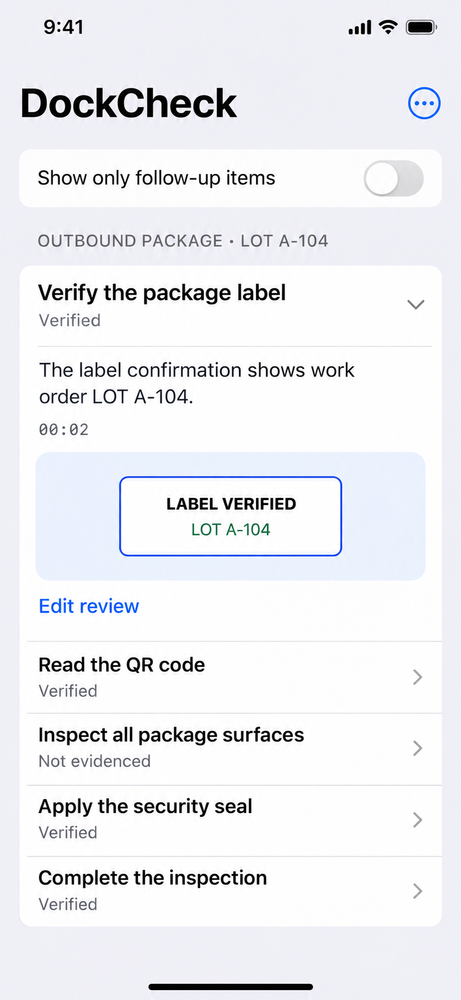
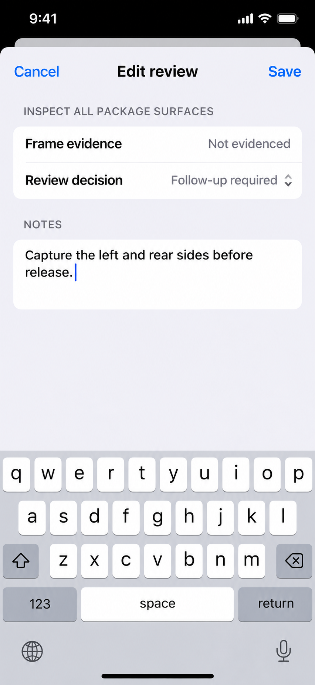
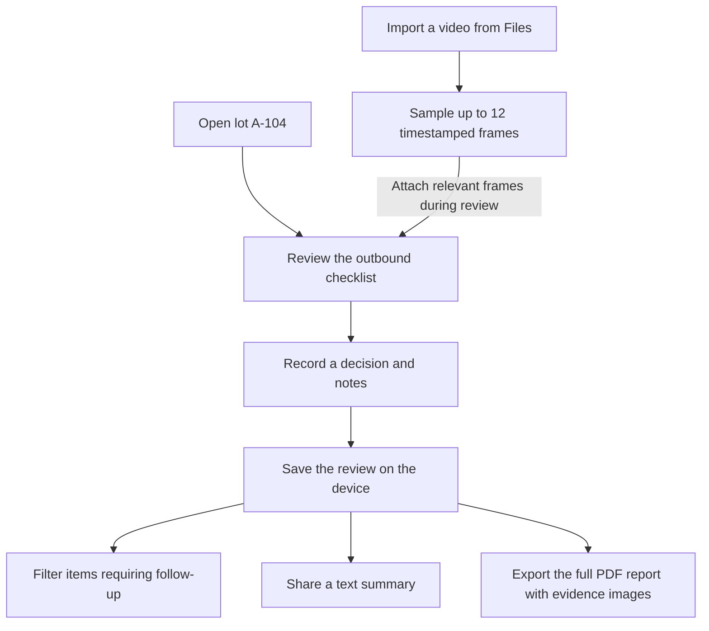

# DockCheck

DockCheck is a SwiftUI iOS app for reviewing outbound package inspections and handing findings over to the next shift. A reviewer can open an inspection video from Files, attach timestamped frames to checklist items, and record which steps are accepted or need follow-up. The handoff can be shared as text or exported as a PDF with supporting images.

<p align="center">
  
  
</p>

*Illustrated previews of the checklist and follow-up note editor for lot A-104.*

## Inspection workflow



### 1. Choose an inspection

Use the bundled inspection for lot **A-104** to explore the package label, QR scan, surface inspection, security seal, and completion checks. The surface check is marked **Not evidenced** because the available frames show only the top of the package. The reviewer can flag the step for follow-up and request footage of the missing sides.

To review your own footage, choose **Inspection → Import video** and select a video from Files. Supported clips run from 1 second to 2 minutes and can be up to 250 MB. Expand **Video frames** to browse the sampled frames. Each timestamp identifies where the frame appears in the source video.

### 2. Review the evidence

Expand a checklist item, then choose **Edit review**. For imported inspections, attach the frames that support your decision. A reviewer assigns the decision for each step.

| Decision | When to use it |
| --- | --- |
| **Pending** | The step still needs a decision. |
| **Accepted** | The reviewer has enough evidence to accept the step. |
| **Follow-up required** | The next shift needs to recheck the step or request more footage. |

Add a note with the next action, such as asking for a clear view of all four sides of the carton. Use **Show only follow-up items** to focus the checklist on unresolved steps. Frames, decisions, and notes are saved on the device. DockCheck keeps one imported inspection alongside lot A-104 and asks for confirmation before replacing the imported inspection. Export the current report first if you need a record of it.

### 3. Prepare the handoff

**Review summary** shows how many steps have a decision and how many require follow-up. **Share summary** sends a text handoff with decisions, notes, and frame timestamps. **Export PDF** saves the full checklist with those findings and the supporting images. Both reports include every check, even when the follow-up filter is active.

## Run locally

On macOS with Xcode and an iOS 17 or later simulator runtime, run the following from the repository root.

```sh
brew install xcodegen
xcodegen generate
open DockCheck.xcodeproj
```

Select an iPhone simulator in Xcode and press **Run**.

## Project structure

| File | Responsibility |
| --- | --- |
| [DockCheckApp.swift](DockCheck/DockCheckApp.swift) | SwiftUI checklist, frame browser, review editor, and share controls |
| [Inspection.swift](DockCheck/Inspection.swift) | Checklist data, decisions, notes, and text report |
| [VideoInspection.swift](DockCheck/VideoInspection.swift) | AVFoundation frame sampling and local storage for imported inspections |
| [InspectionPDF.swift](DockCheck/InspectionPDF.swift) | PDF export with report text and supporting images |

## License

[MIT](LICENSE).
